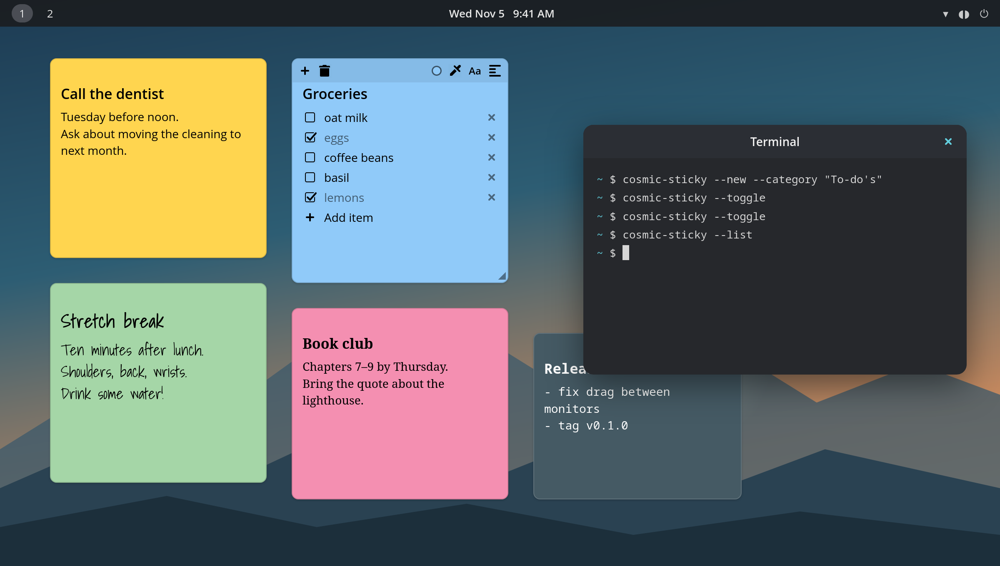
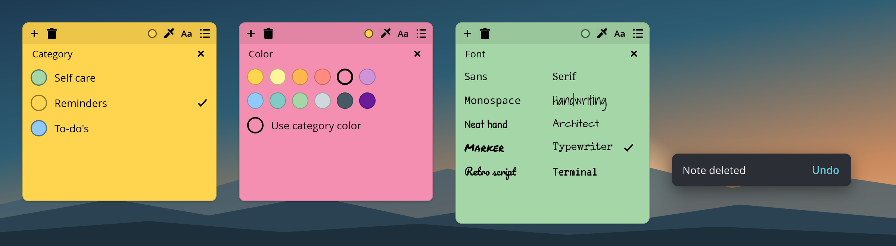
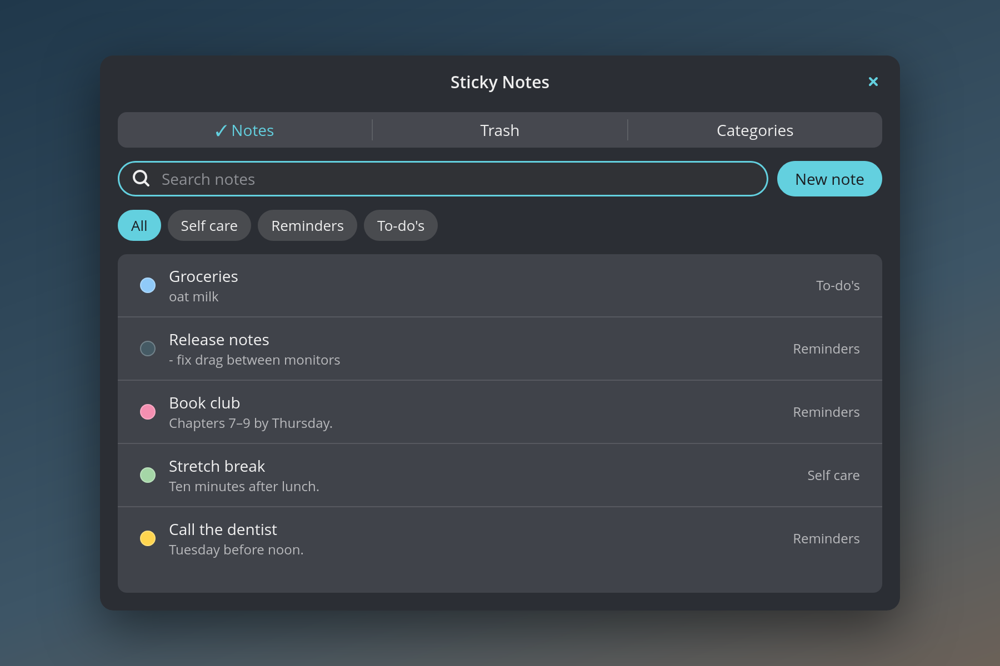

# cosmic-sticky

Sticky notes that live on your desktop, for the [COSMIC](https://system76.com/cosmic) desktop
on Pop!_OS. Notes sit behind your windows like paper on a desk, stay where you put them on
every monitor, and are saved as plain Markdown files you can read, edit, back up or sync.



Written in Rust with [libcosmic](https://github.com/pop-os/libcosmic). It uses almost no CPU
while idle and redraws only when something changes.

## Features

- **Notes pinned to the desktop.** They sit below normal windows, survive restarts and logins,
  and remember their position and size on each monitor. Drag a note by its top edge, including
  from one monitor to the other, and resize it from the bottom-right corner.
- **Text or checklist.** Any note can switch between free text and a to-do list without losing
  anything. Check items off, press Enter for a new item, Backspace on an empty one to remove it.
- **Categories with colors.** Ships with *Self care*, *Reminders* and *To-do's*; add, rename,
  recolor or delete your own. Deleting a category moves its notes to the one you choose.
  Any single note can also have its own color.
- **Readable on any color.** Text switches between black and white for good contrast.
- **Ten fonts,** each previewed in the picker: Sans, Serif, Monospace, Handwriting, Neat hand,
  Architect, plus a few with more character: Marker, Typewriter, Retro script and Terminal.
- **Trash with undo.** Deleting a note shows an *Undo* button for 10 seconds; deleted notes
  stay in the trash for 7 days and can be restored from the list.
- **Notes list.** Search titles and text, filter by category, click a note to bring it in
  front of your windows for a moment, and manage the trash and categories.
- **Show or hide all notes** with one command, handy on a keyboard shortcut.
- **Plain files with live reload.** Edit a note in any text editor or sync the folder with
  Syncthing; changes show up on the desktop within a second.





## Requirements

- The COSMIC desktop (cosmic-comp) on Wayland, e.g. Pop!_OS 24.04. Notes are drawn with the
  layer-shell protocol, so other desktops are not supported.
- To build: Rust (the version in `rust-toolchain.toml` is installed automatically by
  `rustup`), [`just`](https://github.com/casey/just), and the usual libcosmic build
  dependencies:

  ```sh
  sudo apt install just pkgconf libexpat1-dev libfontconfig-dev libfreetype-dev libxkbcommon-dev
  ```

## Install

```sh
git clone https://github.com/Allan-J0hn/cosmic-sticky.git
cd cosmic-sticky
just install
cosmic-sticky &
```

`just install` builds a release binary and installs it to `~/.local` (no `sudo`), together
with an app-grid entry and an autostart entry, so the notes come back at every login.
Set `PREFIX` to install somewhere else.

## Using it

Hover over a note to show its controls:

| Control | What it does |
|---|---|
| **+** | New note next to this one, asking for its category |
| trash can | Delete (with *Undo*) |
| colored dot | Category |
| eyedropper | Note color, or back to the category's color |
| **Aa** | Font |
| list icon | Switch between text and checklist |
| top edge | Drag to move |
| ◢ | Drag to resize |

Press **Escape** to stop editing. Open the notes list from the app grid (*Sticky Notes*) or
with `cosmic-sticky --list`.

### Command line and keyboard shortcuts

Commands are sent to the running instance (or start it):

```sh
cosmic-sticky                              # start (this is what autostart runs)
cosmic-sticky --new                        # new note, pick its category
cosmic-sticky --new --category "To-do's"   # new note in a category
cosmic-sticky --toggle                     # hide or show all notes
cosmic-sticky --list                       # open the notes list
```

To get keyboard shortcuts, add these commands in **COSMIC Settings → Keyboard → Custom
shortcuts**, for example `cosmic-sticky --new` and `cosmic-sticky --toggle` on two free key
combinations. A new note opens in front of your windows so you can start typing
right away.

## Your notes are plain files

Everything lives in `~/.local/share/cosmic-sticky/`:

```text
notes/<id>.md       one file per note
trash/<id>.md       deleted notes, removed for good after 7 days
categories.yaml     your categories and their colors
settings.yaml       whether notes are shown or hidden
conflicts/          an outside edit that lost against your own (never thrown away)
corrupt/            files that could not be read, kept for you to fix
```

A note is Markdown with a small YAML header:

```markdown
---
id: 6f1c2a90-3b1e-4d2f-9a7c-0e5b8d4f1a23
title: Groceries
category: todos
color_override: null
font: handwriting
mode: checklist
x: 700.0
"y": 500.0
width: 260.0
height: 240.0
output: eDP-1
created: "2026-11-04T17:00:00Z"
modified: "2026-11-04T17:05:00Z"
---
- [ ] coffee beans
- [x] eggs
```

Files are written atomically (temporary file, then rename), so a crash never leaves a
half-written note. The folder can be synced between machines with Syncthing or similar.

## Uninstall

```sh
just uninstall
```

This removes the program, the app-grid entry and the autostart entry. Your notes stay in
`~/.local/share/cosmic-sticky/`; delete that folder too if you want them gone.

## Development

```sh
just run       # build and run with debug logging
just test      # unit tests
just check     # clippy
```

`tools/e2e/` holds the end-to-end scripts used during development. They drive a real COSMIC
session with simulated input, so read them before running them.

## Known limitations

- COSMIC only; no Flatpak, since sandboxed apps may not draw on the desktop layer.
- Fractional display scaling has not been tested.
- A desktop icon underneath a note can't be clicked; the note takes the click.

## License

GPL-3.0-only, see [LICENSE](LICENSE). The bundled fonts keep their own licenses, included
next to them in `resources/fonts/`: *Shadows Into Light*, *Patrick Hand*, *Architects
Daughter*, *Pacifico* and *VT323* under the SIL Open Font License; *Permanent Marker* and
*Special Elite* under the Apache License 2.0.
